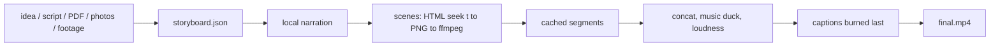

<h1 align="center">videomaker</h1>

<p align="center">
  <a href="https://github.com/matheussilvano/videomaker/actions/workflows/ci.yml"></a>
  
  
  
  <a href="LICENSE"></a>
  <a href="CONTRIBUTING.md"></a>
</p>

<p align="center"><b>Make a finished video with Claude Code.</b> Give it an idea, a script or a PDF, some photos or raw footage, and get <code>final.mp4</code>: narrated by a free local voice, animated by a cartoon host, captioned in the Reels style. No account, no API key, no cloud.<br>
<a href="docs/storyboard.md">storyboard</a> · <a href="docs/architecture.md">architecture</a> · <a href="CONTRIBUTING.md">contributing</a></p>

<p align="center"></p>
<p align="center"><sub>This demo is built from <a href="examples/demo-en/storyboard.json">examples/demo-en</a> with <code>make demo</code>.</sub></p>

---

## What it does

| You say | Videomaker does |
| --- | --- |
| "Make a 45 s ad for this trip, here is the PDF and the photos." | reads the PDF, writes a storyboard, narrates it, animates it, burns captions |
| "Turn this script into a Reel." | one `story` scene per beat: cartoon host + info card + caption, ~3-5 s each |
| "Clean up this talking-head take and add an intro." | transcribes locally, cuts fillers (video-use), joins it with generated scenes |
| "Make the second scene faster." | edits one scene; only that scene re-renders (content-hash cache) |

- **Flat-illustration host** (SVG, no assets): points, waves, cheers; mouth follows the narration; colors configurable.
- **Scene types**: `story`, `title`, `bullets`, `stat`, `quote`, `photo`, `contact`, `media` (your footage), `html` (your own `seek(t)` page).
- **Free narration** with [Kokoro](https://github.com/thewh1teagle/kokoro-onnx): English, Portuguese, Spanish, French, Italian, Hindi, Japanese, Chinese.
- **Captions** `clean` or `impact` (huge Anton caps, thick outline), SRT export, burned last.
- **Deterministic**: scenes are pure functions of time, so the same storyboard gives the same frames.
- **Honest by design**: the skills forbid invented prices/dates/claims and require credit for photos.

## Start in 2 minutes

### Option A: Claude Code plugin (recommended)
```text
/plugin marketplace add matheussilvano/videomaker
/plugin install videomaker@videomaker
```
Then ask: *"make a 40 second vertical video about …"*. The `setup` skill installs what is missing. Skills: `/videomaker:make`, `:footage`, `:storyboard`, `:setup`. Requires [uv](https://docs.astral.sh/uv/) and ffmpeg.

### Option B: the CLI alone
```bash
uv tool install git+https://github.com/matheussilvano/videomaker
videomaker setup            # narration models (~120 MB), browser, upstream skills
videomaker doctor
```
```bash
git clone https://github.com/matheussilvano/videomaker && cd videomaker
make setup && make demo     # builds out/demo/final.mp4
```

## How it works



Details: [docs/architecture.md](docs/architecture.md). Custom scenes: [docs/scenes.md](docs/scenes.md). Narration: [docs/narration.md](docs/narration.md).

## Commands
```bash
videomaker validate storyboard.json            # plan and durations
videomaker still storyboard.json hook -t 2.5   # one PNG, in seconds
videomaker build storyboard.json -o out        # final.mp4, captions.srt
videomaker transcribe take.mp4 --language pt   # free local transcript for video-use
videomaker voices                              # list narration voices
```

## Validation status (no makeup)

| Area | State |
| --- | --- |
| Storyboard validation, timing, captions, cache, end-to-end render | ✅ automated tests (Linux, Chromium/Chrome, ffmpeg 4.4+) |
| Mouth sync, poses, HUD, photo cards | ✅ checked on rendered frames; no automated pixel tests |
| Narration per language | ⚠️ English and Portuguese synthesize correctly; nobody has judged the voices by ear yet, other languages untested |
| macOS / Windows | ⛔ not tested |
| Caption timing | proportional per cue, not word-aligned ([roadmap](docs/roadmap.md)) |

## Privacy
No server, no telemetry. See [docs/privacy.md](docs/privacy.md). Photos keep their own licenses; credit what needs credit.

## Credits and license
MIT. Built on FFmpeg, Playwright, Kokoro, [video-use](https://github.com/browser-use/video-use) and [claude-motion-design](https://github.com/howseen-ai/claude-motion-design) (both MIT, optional, pinned). Fonts: Anton and Montserrat (OFL). See [NOTICE](NOTICE).
