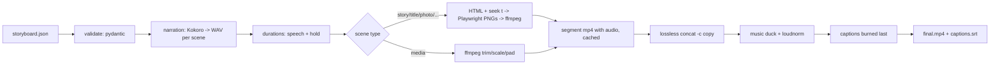

# Architecture

- **One recipe per segment.** Every segment is H.264/AAC with identical parameters, so joining is `-c copy` and nothing is encoded twice.
- **Cache key** = scene JSON, format, style, HUD, character, measured audio length, source file size/mtime, template hash and tool version. Edit one scene and only that scene re-renders.
- **Narration drives time.** Speech length decides the scene length; the host's mouth uses the narration loudness per frame (`assemble.mouth_envelope`).
- **Captions** are timed proportionally to word length inside each narration. That is accurate to a fraction of a second per cue, not word-aligned (see roadmap).
- **Skills** (`plugin/skills`) are the agent's playbook; the Python package is the engine. The agent never needs to write ffmpeg commands.
